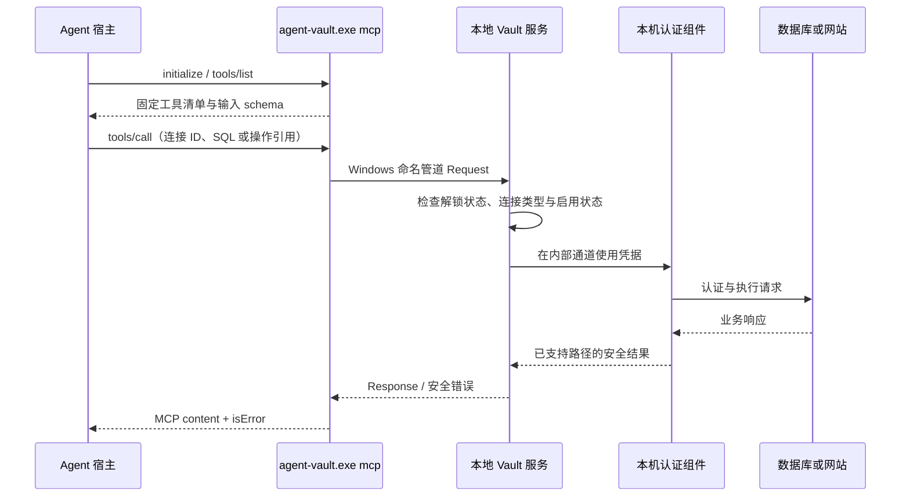

# Agent Vault MCP 接入与实现

适用版本：0.1.7。更新日期：2026-10-23。

Agent Vault 的 MCP 是本地 stdio 服务。客户端启动 `agent-vault.exe mcp` 后，通过标准输入和输出调用固定的 11 个工具；MCP 进程将请求转发给已经运行的 Vault 服务。密码、私钥仍由本机 Vault 与认证组件使用，配置文件无需填写这些凭据。

## 接入前准备

1. 启动 Agent Vault，在本机管理窗口创建或解锁保险库。
2. 在本机添加需要使用的连接并启用该连接。SSH 还需要用户开启“SSH 客户端接入”，以及服务器已配置对应公钥。
3. 在“Agent 集成”的“MCP 接入”中复制配置。该处使用当前程序的完整路径与实际保险库目录，适合复制到客户端。

MCP 进程与后台 Vault 服务是两个进程。MCP 初始化及工具发现不依赖保险库解锁，但实际调用要求服务运行并符合当前授权。`vault_open` 能显示正在运行的服务的管理窗口，不能在服务未运行时替代启动服务。

以下示例使用本机开发路径 `C:/workspace/safe/dist/agent-vault.exe`。移动安装目录后请使用实际完整路径，不能假设程序已加入 PATH。

## Codex

在 PowerShell 运行下列注册命令，然后重新加载 MCP 或开启新的会话：

```powershell
codex mcp add agent-vault -- 'C:\workspace\safe\dist\agent-vault.exe' mcp
codex mcp list
```

也可以将以下片段合并到 `%USERPROFILE%\.codex\config.toml`，保留已有配置，不要覆盖整个文件：

```toml
[mcp_servers.agent-vault]
command = "C:/workspace/safe/dist/agent-vault.exe"
args = ["mcp"]
tool_timeout_sec = 90
```

使用自定义保险库时，参数改为：

```toml
args = ["--data-dir", "C:/path/to/your-vault", "mcp"]
```

`--data-dir` 放在 `mcp` 之前，且必须与后台服务使用同一目录。默认目录为 `%LOCALAPPDATA%\AgentVault`。配置目录路径无需密码或私钥。

stdio 的 command、args、cwd 配置及 `codex mcp add` 语法依据 [OpenAI 官方 MCP 文档](https://learn.chatgpt.com/docs/extend/mcp?surface=cli)；超时等字段见 [配置参考](https://learn.chatgpt.com/docs/config-file/config-reference)。具体客户端和版本仍需实际加载确认。

## Claude Code

在本机 PowerShell 中注册用户级本地服务：

```powershell
claude mcp add --transport stdio --scope user agent-vault -- 'C:\workspace\safe\dist\agent-vault.exe' mcp
claude mcp get agent-vault
```

随后在 Claude Code 中用 `/mcp` 查看是否已连接，必要时重新加载或开启新会话。这里不自动修改任何宿主权限。注册命令会写入该客户端的配置，按实际需要执行。

项目级配置也可使用 `.mcp.json`，合并以下内容并在宿主中确认加载：

```json
{
  "mcpServers": {
    "agent-vault": {
      "type": "stdio",
      "command": "C:/workspace/safe/dist/agent-vault.exe",
      "args": ["mcp"]
    }
  }
}
```

自定义数据目录同样使用 `"args": ["--data-dir", "C:/path/to/your-vault", "mcp"]`。stdio 与用户级安装语法见 [Claude Code 官方 MCP 文档](https://code.claude.com/docs/en/mcp)。

## 接入后如何使用

先让 Agent 调用 `vault_status`，再调用 `vault_targets`。返回结果只包含状态和公开连接元数据。根据连接名称选择对应 ID，不把密码放入提示词。

可直接说：

> 使用 Agent Vault 查看“测试数据库”的表结构。

> 使用 Agent Vault 登录“测试网站”，查看登录后的首页。

> 使用 Agent Vault 连接“测试服务器”，查看磁盘使用情况。

最后一项需要宿主同时具备执行本机 SSH 客户端的能力。纯 MCP 客户端如果没有终端工具，当前版本只能拿到 SSH 连接信息，不能独立执行远程命令。

## 工具清单

| 工具 | 参数 | 实际能力 |
| --- | --- | --- |
| `vault_status` | 无 | 状态、版本、组件与 SSH 接入状态 |
| `vault_targets` | 无 | 公开连接元数据，不返回秘密 |
| `vault_open` | 无 | 打开正在运行的 Vault 管理窗口 |
| `vault_ssh_config` | `target` | SSH 地址、用户、公钥与原生客户端路径等公开信息 |
| `vault_db_test` | `target` | 内部取密并测试数据库连接 |
| `vault_db_schema` | `target` | 读取数据库结构 |
| `vault_db_query` | `target`, `sql`, 可选 `parameters` | 内部连接器执行 SQL，权限由数据库账号决定 |
| `vault_browser_login` | `target` | 本机取密并在托管浏览器认证 |
| `vault_browser_snapshot` | `session` | 观察登录后的托管会话 |
| `vault_browser_click` | `session`, `ref` | 点击快照返回的 `@eN` 引用 |
| `vault_browser_close` | `session` | 关闭托管会话 |

数据库查询参数只是 SQL 的业务参数，不能在其中填写认证密码。浏览器 `session` 是 Vault 生成的操作引用，不是网站 Cookie 或会话密钥。

## 实现原理



- **协议层**：`cmd/agent-vault/mcp.go` 使用 Go 标准库逐行读取 JSON-RPC，处理 `initialize`、`ping`、`tools/list`、`tools/call`，忽略无需响应的通知。当前声明协议版本为 `2024-11-05`，并未采用 MCP SDK 或实现所有扩展。
- **工具映射**：工具名映射为本地操作，例如 `vault_db_query` 对应 `db.query`。解析公开参数后构造 `vault.Request`，通过 `vault.Call` 连接由数据目录确定的命名管道。
- **执行层**：`internal/vault/host.go` 分发请求。数据库调用原有连接器；浏览器调用原有托管会话与私有认证适配器。薄 MCP 进程本身不读取保险库文件或取出生产密码。
- **输出层**：Vault 返回统一 Response。MCP 将其编码为 JSON 文本内容并设置 `isError`，不会把认证组件的原始协议输出当作工具结果。
- **SSH 路径**：`vault_ssh_config` 只获取元数据。宿主随后运行 Windows OpenSSH，SSH 客户端通过 Agent 管道请求 Vault 签名；MCP 不代替 SSH Agent，不提供 `ssh_exec`。

## Skill 与 MCP 的关系

| 项目 | Skill | MCP |
| --- | --- | --- |
| 作用 | 告诉 Agent 如何发现连接、调用程序、处理授权和错误 | 向宿主提供可发现的结构化工具 |
| 执行入口 | Agent 使用终端调用 CLI | 宿主通过 stdio 发起工具调用 |
| 是否包含密码 | 不包含 | 配置、工具 schema 不包含认证密码字段 |
| 是否强制授权 | 由 Vault 执行端检查 | 同样由 Vault 执行端检查 |
| 能否同时安装 | 可以，Skill 补充使用方法 | 可以，共用同一个 Vault |

MCP 的工具清单不是安全隔离本身。真正的凭据处理和已实现的授权检查位于本机执行层。宿主可能另外弹出工具调用确认，该确认与产品的解锁、目标启用是不同机制。

## 当前边界与排查

- 本产品目前没有远程 HTTP / SSE MCP 地址。管理界面的回环 HTTP 地址不是 MCP endpoint，不要把它填成 MCP URL。
- MCP 不提供解锁、启用 SSH、连接增删、原始凭据导出或任意 Shell 工具。需要本机操作时使用管理界面。
- `VAULT_NOT_RUNNING`：先启动后台程序，检查 MCP 与后台程序是否使用同一 Windows 用户、相同数据目录。
- 锁定、目标停用或 SSH 接入关闭：在本机窗口处理相应状态，不回退为聊天输入密码。
- 工具清单出现但无法操作：初始化成功只证明 stdio 桥接已启动，不等于后台服务或远程目标已就绪。
- 当前尚未宣称所有 Codex、Claude Code、OpenClaw 版本均完成端到端兼容。已有本机协议测试不等同于每个宿主实际加载验收。
- 本产品帮助支持的认证路径避免凭据进入模型上下文，不保证同用户恶意进程隔离、任意工具输出过滤或远程业务命令白名单。现有本地使用记录也不是不可篡改合规审计。
