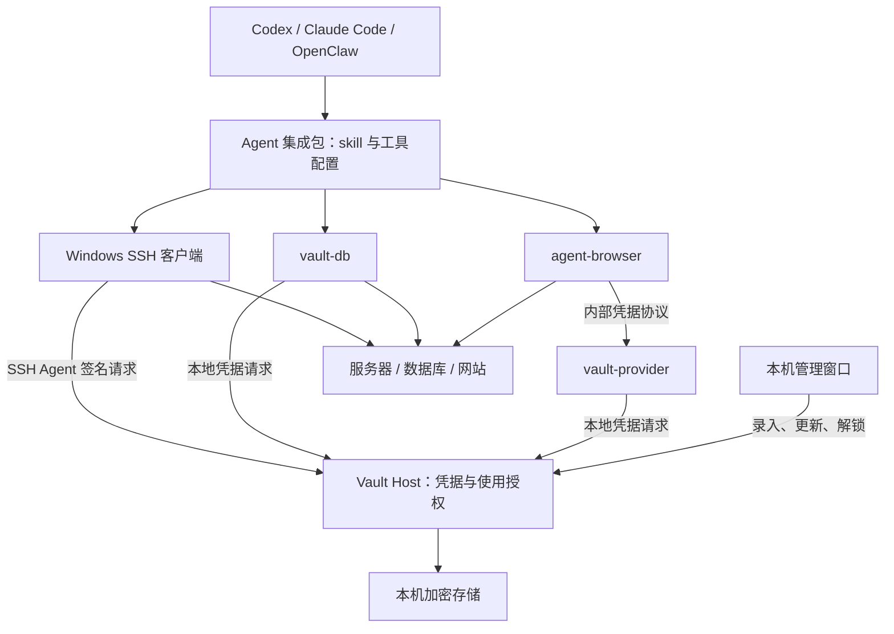
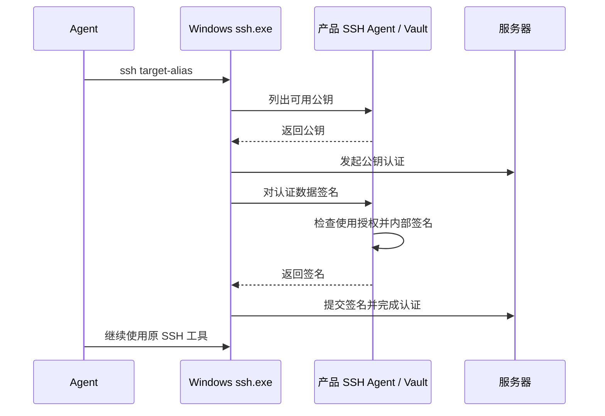
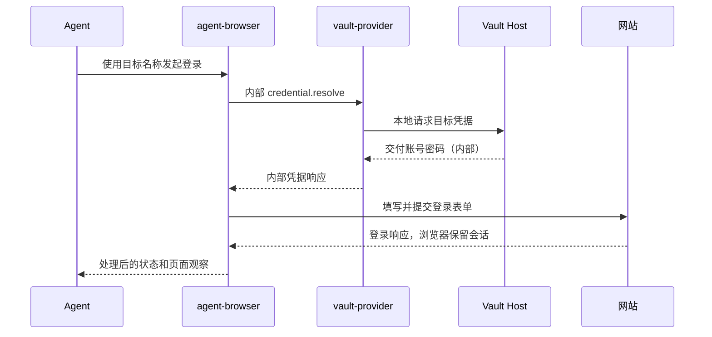

# Windows Agent Vault 产品与技术设计

版本：0.1（设计基线）  
日期：2026-10-22  
状态：待技术验证，尚未实现  
暂定产品名：Agent Vault，与 Automic Vault 无关联。

配套文件：[约束与验收清单](windows-agent-vault-constraints.md)。

实现更新（0.1.6，2026-10-23）：本文保留初始设计基线，实际实现和取舍以 [实现状态](implementation-status.md) 为准。网站现支持账号密码表单、仅密码表单及 JavaScript prompt；仅密码认证由本机私有浏览器适配器执行。远程 HTTP 默认拒绝，可由用户在本机连接设置中明确允许未加密传输。

## 1. 已确认的结论

产品帮助 Codex、Claude Code、OpenClaw 在 Windows 上使用账号、密码、私钥完成认证，避免真实凭据进入大模型请求上下文。

用户安装一个 Agent 集成入口，在本机窗口添加一次目标和凭据，之后用自然语言提出任务。产品负责发现目标、使用凭据和完成认证接入，用户不需要选择客户端、编写取密脚本或手动配置本地通信。

首版适配三种场景：

| 场景 | 已选实现方向 | 登录后的操作由谁负责 |
| --- | --- | --- |
| SSH 服务器 | 本地 Vault 提供 SSH Agent 签名，复用 Windows SSH 客户端 | 原 SSH 客户端 |
| 数据库 | 自研轻量 `vault-db`，内置现成数据库驱动并接入 Vault | `vault-db`，Agent 提交 SQL |
| 网页账号密码 | 复用 agent-browser，开发其凭据提供插件 | agent-browser 及其管理的 Chrome 会话 |

参考 Automic Vault 的原则：把凭据托管与使用放在模型之外，优先利用现有工具的认证入口；需要时提供包装器、插件或有限的专用工具。不能将 Automic Vault 的 macOS 安全机制直接等同于 Windows 上的实现。

产品不承诺所有工具、所有返回路径均不会泄密。对于支持并验证过的流程，真实凭据不由模型提供、不由公共工具接口返回；工具收到凭据后的行为、未覆盖的输出形式保留明确边界。

## 2. 要解决的问题与不扩大范围

### 2.1 核心问题

通常，Agent 在遇到认证时要求用户把密码发进聊天，或者读取 `.env`、连接串、私钥文件，真实凭据随后进入模型请求、工具调用记录或后续对话。

本产品将认证路径改为：

```text
用户在本机窗口录入凭据
        ↓
本地 Vault 保存凭据
        ↓
模型只生成目标名称、凭据引用或正常命令
        ↓
本地组件在执行时使用真实凭据
        ↓
向 Agent 返回登录状态和业务结果
```

### 2.2 首版不包含

- 通用生产运维平台、堡垒机或远程任务调度平台。
- 远端命令白名单、业务风险识别、逐条 SQL 风险判定、网页业务操作审批。
- 自动控制所有 Agent 的全部工具、拦截全部网络流量。
- 仅靠提示词保证任意脚本或客户端不泄密。
- 全面阻止间接提示注入、数据外传或目标系统里的其他秘密被读取。
- 团队云端保险库、跨设备同步、企业 SSO、高可用、集中合规审计。
- 对任意 MFA、验证码、扫码或复杂 SSO 自动登录的保证。

凭据使用确认可以存在，但不扩展为“每执行一个命令都由本产品审批”。

## 3. 术语与组件

| 名称 | 含义 |
| --- | --- |
| Agent | 用户使用的 Codex、Claude Code、OpenClaw 等应用 |
| 模型上下文 | 发给模型的消息、工具参数、工具结果、错误、页面快照、截图和压缩摘要等 |
| Agent 集成包 | 面向具体 Agent 的安装配置、skill、必要的工具注册；各宿主格式可以不同 |
| skill | 告诉 Agent 发现哪些目标、调用哪些命令、遇到缺少凭据时如何处理；不存储秘密 |
| Vault Host | Windows 本地后台程序，管理保险库、解锁状态、凭据使用和组件通信 |
| 本机管理窗口 | 用户录入、更新、删除凭据以及查看连接状态的界面 |
| SSH Agent | 兼容 SSH Agent 协议的认证签名组件，不是大模型 Agent |
| vault-db | 产品提供的轻量数据库命令行程序，可由薄 MCP 接口调用同一实现 |
| agent-browser | 第三方本地浏览器自动化工具，不是 Chrome 扩展，也不是模型 |
| vault-provider | 我们开发的 agent-browser 凭据插件；不是 Chrome 扩展，也不是公开取密工具 |
| 目标 | 用户配置的服务器、数据库或网站，绑定连接参数和凭据引用 |
| 凭据引用 | 无真实秘密的记录标识；不能单独作为取密权限 |

所有命令、文件名、接口名均为设计示例，不代表已有可安装产品。

## 4. 产品承诺与安全边界

### 4.1 产品直接负责

1. 正常登录不要求用户向聊天发送密码或私钥。
2. 产品公开接口只接受目标、引用和操作参数，不返回真实秘密。
3. 私钥认证优先返回签名，不返回私钥。
4. 数据库密码、网页密码仅在本地受支持的执行组件中解析和使用。
5. 产品控制的参数记录、诊断、错误和日志不写入真实凭据。
6. 对支持的输出路径处理托管凭据的直接回显。
7. 未配置、不兼容或失败时报告问题，不回退为让模型读取真实凭据。

### 4.2 不作绝对保证

- 数据库驱动、浏览器工具等获得凭据后仍可能在自身内存或未知输出路径中泄露。
- 任意脚本、进程转储、完整系统控制和管理员攻击不在首版承诺内。
- 转码、加密、分片、截图、复杂页面脚本中的所有泄露形式无法靠字符串替换完全识别。
- 用户主动把密码粘贴到聊天后，本产品不能撤回已经发送的模型请求。
- 未经迁移的旧 `.env`、私钥副本、连接配置或浏览器状态仍可能暴露。
- 会话 Cookie、Token 由原工具使用；首版不新增主动导出能力，也不保证完全覆盖第三方工具所有现有会话导出路径。
- skill 可以引导正确使用，但无法强制 Agent 永远选择产品工具。

### 4.3 同一 Windows 用户下的边界

首版以“支持的认证路径避免把秘密传给模型”为承诺，不宣称能够完全隔离同一用户下的所有任意代码。

DPAPI 的用户保护与文件 ACL 不等于同一用户下可靠的应用隔离。仅凭一个程序叫 `Codex.exe`、用户自报 `client_name` 或位于某个路径，不能证明调用者可信。

如果后续需要抵御同用户恶意进程、调试注入和秘密内存读取，需要独立服务身份、受保护安装位置、调用者认证等额外设计与验证；不得把这些增强描述成首版已经具备。

## 5. 用户体验

### 5.1 首次安装

用户从 Agent 的集成入口启动安装，安装器完成以下步骤：

1. 安装或连接一个本地 Vault Host 和本机管理窗口。
2. 检测当前 Windows 用户及可用 Agent，不读取其他应用的秘密。
3. 检测 Windows OpenSSH、受支持版本的 agent-browser 和 Chrome。
4. 安装 `vault-db`、`vault-provider` 等产品组件。
5. 备份并配置当前 Agent 的工具与 skill；修改范围展示给用户。
6. 运行连通性和接入诊断，逐项显示“就绪 / 需配置 / 不支持”。

“一个插件”指用户只需一次集成入口，不代表底层只有一个文件。Agent 插件系统如不能安装本地程序，应引导用户完成一次本机安装，不假装仅复制 skill 就已生效。

不同 Agent 的插件、MCP、skill 和安装规则可能不同，需分别验证。不把三个宿主的安装接口预设为一致。

### 5.2 添加目标

用户可在本机界面主动添加，也可由 Agent 请求打开新增窗口。

| 类型 | 必填信息 | 凭据输入 |
| --- | --- | --- |
| SSH | 名称、主机、端口、用户名 | 导入私钥；加密私钥的解锁口令在本机输入 |
| 数据库 | 名称、数据库类型、主机、端口、库名、用户名、TLS 配置 | 密码在本机输入 |
| 网站 | 名称、登录 URL、账号；必要时配置登录字段 | 密码在本机输入 |

默认用户名是非秘密连接元数据，因为本需求主要保护密码、私钥和 Token。若账号本身也敏感，可将其一并托管；接口和返回不能假设必须向模型展示账号。

用户保存后，界面发起测试，并明确区分“已保存”和“登录成功”。

### 5.3 日常使用

| 用户自然语言 | Agent 使用的能力 | 用户需要知道客户端名称吗 |
| --- | --- | --- |
| 登录测试服务器，查看磁盘 | SSH 别名与系统 SSH | 不需要 |
| 查询订单库最近一小时订单数 | vault-db | 不需要 |
| 登录公司管理后台并查看状态 | agent-browser + vault-provider | 不需要 |

Agent 可以列出已配置且可使用目标的名称、类型和必要连接元数据。目标重名时澄清具体目标；不通过读取秘密来消除歧义。

### 5.4 缺少凭据或需要解锁

```text
Agent 发起连接
    ↓
工具返回 CREDENTIAL_REQUIRED 或 VAULT_LOCKED
    ↓
打开本机录入/解锁窗口
    ↓
用户在本机完成
    ↓
只发送“就绪/取消”事件
    ↓
原任务重试认证
```

等待采用有界请求、状态查询或事件通知，不能让工具永久阻塞。用户取消、窗口关闭和超时必须有明确结果。重复调用复用同一待处理窗口，避免连续弹窗。

UI 中字段填写完成，不等于网站或数据库验证成功。密码过期、拒绝登录时允许用户在本机更新。

## 6. 总体架构



Vault Host 不成为 SSH 命令代理或网页点击服务。数据库是有意的例外：我们提供小型连接查询程序，避免要求 Agent 自己编写密码连接逻辑。

## 7. 本地通信与存储

### 7.1 Windows 本地通信

产品内部优先使用 Windows 命名管道，消息采用版本化、长度受限的结构。SSH Agent 对外必须使用其标准协议，不能用自定义 JSON 替代。

命名管道不是天然仅限本机。实现必须拒绝远程客户端、配置显式 ACL，并隔离 Windows 用户与登录会话。[S4]

请求区分两类：

| 类型 | 可见范围 | 示例 |
| --- | --- | --- |
| 公共操作 | Agent 可以调用；不返回秘密 | 列目标、测试连接、查询、请求网页登录、打开录入窗口 |
| 内部凭据操作 | 仅支持的消费组件内部使用 | SSH 签名、数据库连接取密、浏览器凭据解析 |

不能把内部 `credential.resolve` 直接注册为 MCP 工具，也不能提供 `vault get-password` 之类公开命令。

浏览器插件的内部协议会交付真实值，因此“插件 stdout 是内部通道”不能被理解为“任意人执行插件都可取到密码”。需绑定受支持浏览器执行实例，拒绝脱离该实例的直接取密请求；具体实现是 P0 验证项。

### 7.2 进程与密钥存储

首版建议为当前用户运行一个托盘应用/后台 Host，降低安装和解锁成本。不要默认安装拥有广泛权限的 LocalSystem 服务。

建议保存格式：

- SQLite 保存目标、引用、版本、使用状态和少量操作记录。
- 使用现成密码学库实施带认证的加密；不自创算法。
- 数据加密密钥由 Windows DPAPI 用户范围保护；不把密钥硬编码或写入配置。
- 凭据文件和密钥文件配置用户级 ACL；不放在项目仓库内。
- 解密后的值仅在必要的内存和内部通道中存在；尽量缩短生命周期。

DPAPI 通常约束解密用户与计算机，不能把它写成“只有我们应用能解密”的保证。首版无跨机自动恢复承诺；备份恢复单独设计。[S5]

### 7.3 最小数据模型

```text
Target
  id, display_name, kind
  connection_config（非秘密；也可能包含隐私）
  credential_id, enabled, version

Credential
  id, kind, encrypted_payload, version
  created_at, updated_at

CredentialUseRule
  target_id, consumer_kind, enabled
  confirmation_mode（按需确认或允许已配置用途）

UseRecord
  request_id, timestamp, target_id, consumer_kind
  decision, status, error_code
```

目标 ID 不是权限凭证。客户端标签用于排错，不作为强安全身份。首版不以“不同模型身份”建立未经验证的权限保证。

## 8. SSH 实现

### 8.1 选定路径

优先支持 Windows OpenSSH 客户端 + 产品 SSH Agent + 私钥认证。账号密码 SSH 认证不列为首版必需，后续如需要可增加专门适配。



### 8.2 配置与行为

安装器检测 SSH 客户端版本及实际选用路径，避免 Git 自带 SSH 与 Windows SSH 使用不同 Agent。客户端的自定义 Agent 端点支持需要实测。

如果当前客户端只能使用标准 Agent 管道，应向用户解释现有 Agent 冲突，提供可回滚切换；不能直接停掉或覆盖用户其他密钥管理软件。

生成非秘密主机别名配置。私钥保存在 Vault 中，不能生成方便模型读取的明文私钥文件。需要指定密钥身份时使用公钥及经验证的客户端配置。

首版支持一种经验证的现代密钥类型，优先 Ed25519；RSA 与其他格式按照兼容性测试逐步开放。导入校验、公钥提取和签名使用成熟实现。

### 8.3 约束

- 默认不开放通过 Agent 协议导出私钥，不支持任意请求方添加、替换或移除保险库密钥。
- 默认不开启 Agent Forwarding。
- 验证服务器主机密钥，不自动关闭校验。未知或变化的主机身份需要本机确认或明确错误。
- 不根据一次签名请求就声称已经知道用户将执行的远端命令。
- 如未实现并验证会话绑定或目标限制，不宣称 SSH 密钥只能在某台主机使用；同一公钥被多处接受时，认证能力可能覆盖多处。
- 拒绝授权只阻止尚未完成的认证；不保证关闭已经建立的 SSH 会话。

### 8.4 SSH 命令接口

用户仍可让 Agent 调用正常的 `ssh target-alias`。产品另提供不含秘密的诊断命令，例如：

```text
vaultctl doctor ssh
vaultctl targets --kind ssh
```

## 9. 数据库实现

### 9.1 为什么提供简版程序

Agent 可能自行编写连接脚本。与其向脚本注入密码并适配任意客户端，首版提供 `vault-db`：Agent 负责编写 SQL，本地程序负责取密、连接与执行。

不开发数据库图形管理器，不自研数据库协议。底层复用现成 PostgreSQL / MySQL 驱动。两个数据库的支持状态分别验收。

### 9.2 接口

```text
vault-db targets --json
vault-db test --target orders --json
vault-db schema --target orders --json
vault-db query --target orders --input query.json --json
```

`query.json` 只含 SQL 和参数，不含密码：

```json
{
  "sql": "SELECT COUNT(*) AS count FROM orders WHERE created_at >= $1",
  "parameters": ["2026-10-22T00:00:00+08:00"]
}
```

以上 SQL 参数语法是 PostgreSQL 示例。实现必须按数据库驱动支持参数绑定，不能假设所有数据库统一使用 `$1`。命令参数使用结构化进程启动，不经拼接 Shell。

### 9.3 执行路径

1. 用目标 ID 读取连接配置。
2. 向 Vault 请求为当前连接用途交付凭据。
3. 在本地连接程序内将密码直接传给数据库驱动。
4. 执行 SQL，处理结果与异常，关闭连接。
5. 返回结构化结果。

首版每次调用建立并关闭连接，避免为连接池和长事务增加复杂度。以后可加持久连接，但必须明确事务状态、超时和退出行为。

### 9.4 返回格式

```json
{
  "ok": true,
  "target": "orders",
  "columns": [{"name": "count", "type": "int64"}],
  "rows": [[120]],
  "truncated": false,
  "request_id": "req-example"
}
```

大整数、时间、二进制、NULL 和 decimal 应有明确序列化约定，避免分析错误。内部持有连接参数与密码，不返回完整连接串。

### 9.5 功能边界

- 默认建议使用数据库只读账号；是否允许写入由用户配置与数据库自身权限决定。
- 不用字符串判断 `SELECT` 来宣称数据库只读安全。
- 首版不提供事务工作台、备份恢复、迁移和管理账号创建。
- 建议初始限制：查询 30 秒、返回最多 1,000 行、总响应 1 MiB；这些是可调整的产品默认值，不是已验证性能。
- 超时、TLS 验证失败或认证失败返回结构化错误；不自动关闭 TLS 校验，不自动用更高权限账号重试。
- Agent 的数据分析脚本可以消费查询结果，但不通过公开接口获取连接密码。

## 10. 浏览器实现

### 10.1 首版方式

复用 agent-browser，不开发浏览器内核或通用网页操作平台。首版由它启动一个独立、可见的 Chrome / Chrome for Testing 会话，使用独立数据目录。

无头模式属于同一技术路线，可后续开放。连接用户已有 Chrome 的 CDP 模式也可后续增加，但不自动视为具有与独立会话相同的输出防护。

agent-browser 是本地自动化程序；`vault-provider` 是它的外部凭据插件，二者都不是 Chrome 扩展。官方插件机制通过本地 stdio 协议完成 `credential.resolve`。[S3]

### 10.2 登录调用

由集成包封装完整参数，用户只说“登录公司后台”。模型可见命令示例：

```text
agent-browser auth login company-console --credential-provider vault
```

安装器需要根据实际验证版本配置凭据条目、URL 和必要字段选择器。该示例不意味着任意站点无需配置即可登录。



### 10.3 provider 责任

- 实现并版本化适配 agent-browser 的实际插件协议。
- 验证目标引用与本机保存的登录 origin，不接受页面文字作为用户授权。
- 将秘密仅返回已支持的浏览器内部凭据通道，不打印调试信息。
- 失败时只返回标准错误，不返回部分账号密码结构。
- 不将密码、Vault 解锁凭据或内部授权值放进插件启动参数。
- 本机进程通信与 Agent 可见工具结果必须使用不同记录通道。

需重点验证：provider 插件能否取得可信的当前页面/登录目标信息，是否可被直接启动取密，是否能在不修改 agent-browser 的前提下完成消费实例绑定。若不满足，采用薄包装器或最小补丁，不用提示词掩盖缺口。

### 10.4 表单和会话

- 先支持常见账号密码表单；多步登录使用站点配置或按页填写。
- 密码字段、提交失败页面、错误快照和 trace 必须纳入测试。
- 填写成功不能直接报告认证成功；需通过页面跳转、成功元素或站点配置判断。无法确定时报告“已提交，登录状态待确认”。
- MFA、验证码、扫码进入本机人工接管，结束后 Agent 在同一会话继续。
- 密码在同一目标内可受支持使用，不允许模型通过改 URL 将其主动填到任意网站。
- Cookie、localStorage 等由浏览器会话保留，不经产品公共接口导出。
- 不把完整 CDP 地址、浏览器状态文件、Cookie 内容作为正常登录结果交给模型。
- 用户的日常 Chrome 配置与本产品数据目录分开，退出不影响日常浏览器。

### 10.5 登录后操作

点击、查看页面、下载等由 agent-browser 提供。首版不增加网页业务风险审批，也不保证识别任意点击的业务含义。

第三方工具现有的任意脚本、网络调试和状态导出能力可能突破登录路径的输出保护。首版集成避免默认启用这些不必要能力，并披露实际覆盖范围；不能声称产品接管了其他工具的所有调用。

## 11. Agent 接入方式

### 11.1 集成包内容

```text
Agent 集成包
  安装与诊断入口
  skill（不含秘密）
  目标发现与本机录入请求工具
  vault-db 注册或命令说明
  agent-browser 与 provider 配置
  SSH 客户端接入检查
```

统一的是用户体验和本地程序，不要求三个 Agent 宿主使用相同插件格式。公共 CLI 是跨宿主基础；支持的宿主可增加薄 MCP 包装，复用相同的本地逻辑。

### 11.2 skill 的明确行为

1. 发现可用目标，按用户意图选择目标。
2. SSH 使用已配置别名；数据库使用 vault-db；网页登录使用已配置 provider。
3. 不请求用户在聊天中提供密码或私钥。
4. 不读取保险库、旧凭据文件或环境变量来绕过认证失败。
5. 缺少凭据时打开本机录入窗口。
6. 不把带密码的 URL、Shell 命令或连接串写到脚本中。
7. 不为排错开启包含真实认证材料的详细输出。
8. 不通过 Cookie 导出或原始 provider 调用获取秘密。

这些规则改善使用路径，执行端仍须实施自身的接口边界；skill 不是安全强制机制。

### 11.3 建议公共接口

| 接口 | 输入 | 返回 |
| --- | --- | --- |
| targets.list | 类型、筛选条件 | 名称、类型、必要元数据 |
| target.setup | 目标类型与非秘密提示 | 本机窗口状态、请求编号 |
| vault.status | 无秘密参数 | 就绪、锁定、未安装等 |
| db.test / db.schema / db.query | 目标、SQL 与参数 | 结果或标准错误 |
| browser.login | 目标、现有会话引用（可选） | 登录状态、原工具会话引用 |

browser.login 是对原工具登录操作的薄包装，不提供另一套点击/截图服务。不存在公开的 secrets.get、private_key.export 或 cookies.export。

## 12. 凭据使用授权

授权保持轻量，不引入此前讨论过的完整生产操作权限平台。

用户在本机保存目标时选择是否允许产品支持的组件为该目标使用凭据。未启用、Vault 锁定或用途不匹配时拒绝或请求本机确认。用户可取消、禁用目标或锁定保险库。

“已授权使用凭据”不等于“已授权所有业务操作”：SSH 远端命令权限、数据库账号权限、网站账号权限仍由原系统决定。

允许、拒绝及使用记录只保存引用、时间、消费组件和结果，不记录真实值。首版记录不是防篡改证据链，也不记录全量终端会话或 SQL 结果。

禁用目标阻止后续取密或签名，不保证立即撤销第三方工具已经获得的密码或已建立的会话。数据库可在下一次调用阻止新连接；浏览器现有会话如要退出需显式关闭。

## 13. 输出、错误与日志

### 13.1 两条不同的数据通道

```text
Agent 可见通道：目标、引用、命令、SQL、状态、结果、标准错误
内部凭据通道：真实密码、私钥签名处理、provider 私密响应
```

不能将内部协议的完整消息记录到 Agent 可读取的输出。通用的“打印所有请求/响应”日志中间件不适用于凭据通道。

### 13.2 处理规则

- 产品控制的 JSON 和日志采用字段白名单。
- 驱动异常转为代码与经过处理的短消息；不直接输出堆栈对象、完整配置或连接串。
- 对当前请求使用过的托管密码执行直接回显匹配；URL 编码等形式是否支持，列入覆盖清单并测试。
- 流式输出需考虑秘密跨块，不允许逐块简单替换造成遗漏。
- 浏览器的文本与截图属于不同路径，不能用文本替换宣称截图也受保护。
- 主动截图/trace 默认不覆盖凭据填写中的瞬间；失败快照先走敏感字段处理，具体能力由浏览器 PoC 验证。
- 不落地明文临时凭据文件、不启用含密码的进程启动日志。
- 响应处理自身失败时返回标准错误，不回退输出未经处理的原始内容。

### 13.3 错误代码

| 代码 | 含义 | 下一步 |
| --- | --- | --- |
| VAULT_NOT_INSTALLED | 缺少本地组件 | 引导安装 |
| VAULT_LOCKED | 未解锁 | 打开本机解锁窗口 |
| TARGET_NOT_FOUND | 目标不存在 | 选择或添加目标 |
| CREDENTIAL_REQUIRED | 目标未配置凭据 | 打开本机录入窗口 |
| CREDENTIAL_USE_DENIED | 当前使用未被允许 | 展示状态，不尝试读密码绕过 |
| AUTH_FAILED | 对端拒绝认证 | 引导在本机更新凭据 |
| HOST_IDENTITY_CHANGED | SSH 主机身份变化 | 本机核验 |
| TLS_VALIDATION_FAILED | 数据库或网站证书校验失败 | 检查目标配置 |
| LOGIN_STATE_UNKNOWN | 表单已提交但不能确认成功 | 返回处理后的页面供继续判断 |
| INTERACTION_REQUIRED | MFA、验证码等需要用户 | 本机接管后继续 |
| ADAPTER_UNSUPPORTED | 当前工具或版本未适配 | 提供支持版本说明 |
| TIMEOUT / CANCELLED | 超时或用户取消 | 有界重试或结束 |
| OUTPUT_PROCESSING_FAILED | 输出处理失败 | 不返回原始输出 |

## 14. 安装、更新、迁移与卸载

- 依赖使用受信来源、固定测试版本及完整性校验；不默认追随 latest。
- 首版 Windows 11 x64 为计划验证基线；其他系统版本和架构不预先宣称支持。
- 浏览器首版独立可见会话；数据库首版 PostgreSQL 与 MySQL 分别通过测试；SSH 首版 Windows OpenSSH 私钥认证。
- 用户已有工具版本不匹配时，优先提供产品管理的兼容安装，不无提示覆盖全局工具。
- 不把全局 PATH 置换当作不可绕过的安全机制。
- 配置修改前备份；卸载只还原本产品写入的内容，保留用户之后的修改。
- 导入旧私钥后提醒处理旧副本，不未经用户操作就删除原文件。旧副本状态是已知风险，不伪报已完全迁移。
- 升级需测试 IPC、数据库格式、provider 协议与 Agent 配置兼容；数据迁移前备份并记录版本。
- 卸载时让用户选择保留或删除保险库；两者均给出明确结果。

## 15. 技术选型与验证顺序

| 项目 | 当前决定 | 仍需验证 |
| --- | --- | --- |
| 平台 | Windows 优先、本地运行 | Windows 11 x64 基线 |
| Vault UI/Host | 托盘/桌面管理 + 后台 Host | 单用户进程模型、解锁和自动启动 |
| 语言 | 尚未锁定；选择可可靠调用 Windows IPC/DPAPI、SSH 签名和数据库驱动的成熟栈 | 小型原型比较部署与依赖成本 |
| 存储 | 本地数据库 + 成熟加密库 + DPAPI 保护密钥 | 恢复、损坏处理、内存生命周期 |
| SSH | 标准 Agent 接口 | 客户端版本、管道、密钥类型与现有 Agent 共存 |
| 数据库 | 自有简版连接器 | 驱动许可、TLS、类型、错误处理 |
| 浏览器 | agent-browser + 自研 provider | 实际协议、Windows、取密入口边界、失败快照 |
| Agent | 公共 CLI + 各宿主集成包；可加薄 MCP | 每个宿主的安装、调用、重试和会话行为 |

以下问题必须先用无真实生产凭据的原型回答：

1. **SSH**：能否用 Vault 内私钥完成签名，且不导出私钥；Windows 客户端如何选择管道。
2. **浏览器**：插件协议实际字段、URL 校验、直接调用 provider 的行为、失败路径和日志内容。
3. **数据库**：两个驱动正常认证与失败时是否会在异常中暴露配置。
4. **Windows 存储**：DPAPI 与进程模型能支持怎样的边界，界面是否准确表达。
5. **Agent 集成**：三个宿主分别能否发现目标、等待本机录入并继续原任务。

不得以未经实测的 Windows 支持、插件接口或截图脱敏行为作为发布承诺。

## 16. 里程碑与验收

### M0：验证技术路径

使用专门测试凭据与本地测试服务，完成 SSH 签名、数据库认证、网页登录及结果返回；检查上下文与工具日志。产出支持版本矩阵和已知缺口。

### M1：凭据录入与单场景闭环

完成本机 UI、加密存储、目标配置和 SSH。用户通过一个集成入口安装后，无需在聊天输入私钥即可执行测试命令。

### M2：数据库连接器

完成 PostgreSQL/MySQL 的 test、schema、query、TLS 与结构化错误，覆盖正常认证和认证失败。

### M3：浏览器登录

完成 agent-browser provider、独立可见 Chrome 会话、标准及分步表单、失败回显和人工接管。

### M4：三 Agent 与交付体验

完成宿主安装/卸载、配置备份、目标发现、本机录入等待、升级兼容和用户文档。三个宿主各自通过测试后才标记支持。

验收以配套约束清单中的可执行场景为准，不以“日志里没看见密码”单项判定整个产品安全。

## 17. 外部依据与事实分层

本文件是我们的设计，不是 Automic Vault 的移植说明。外部事实和本产品决定必须分开：

| 依据 | 已确认的外部事实 | 本产品据此作出的设计 |
| --- | --- | --- |
| S1 | Automic Vault 使用工具加固、脚本、代理及直接注入等不同机制 | 各场景采用不同接入机制 |
| S2 | 代理给应用替代值，出口应用真实凭据；响应过滤不是通用保证 | 避免模型取密，保留明确输出边界 |
| S3 | agent-browser 提供凭据插件、可见窗口与 CDP 能力 | 首版独立可见窗口 + provider；后续再适配既有 Chrome |
| S4 | Windows 命名管道支持 IPC，需专门限制本地与访问权限 | 本地管道 + 显式远程拒绝和 ACL |
| S5 | DPAPI 通常基于用户登录凭据保护数据 | 用户范围密钥保护，不宣称应用独占解密 |

资料核对日期：2026-10-22。网页跟随主分支会变化，落地时应固定对应版本或提交。

- [S1：Automic Vault 机制选择](https://github.com/automic-vault/automic-vault/blob/main/docs/choosing-a-mechanism.md)
- [S2：Automic Vault Secret Proxy 与边界](https://github.com/automic-vault/automic-vault/blob/main/docs/secret-proxy.md)
- [S3：agent-browser README、插件与浏览器模式](https://github.com/vercel-labs/agent-browser/blob/main/README.md)
- [S4：Microsoft Windows Named Pipes](https://learn.microsoft.com/en-us/windows/win32/ipc/named-pipes)
- [S5：Microsoft CryptProtectData / DPAPI](https://learn.microsoft.com/en-us/windows/win32/api/dpapi/nf-dpapi-cryptprotectdata)
